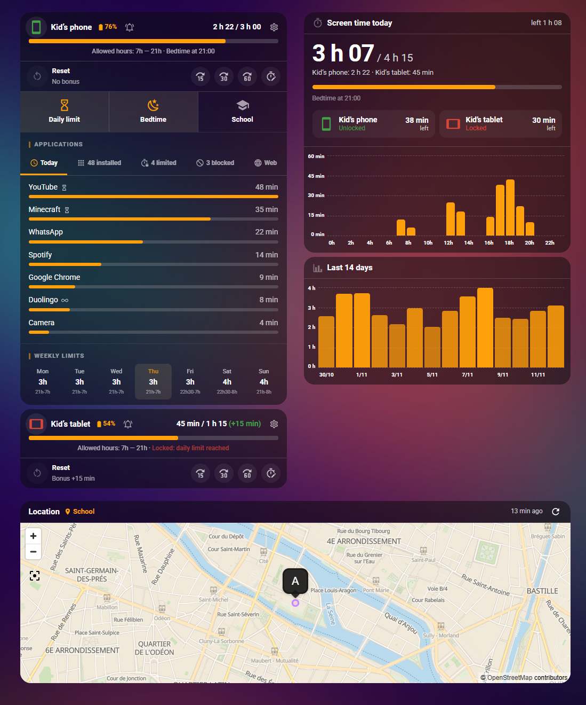
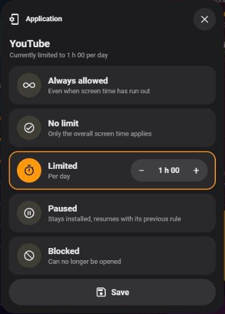
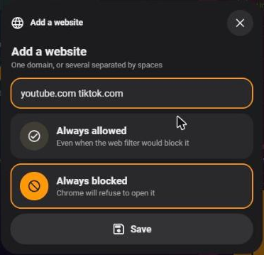
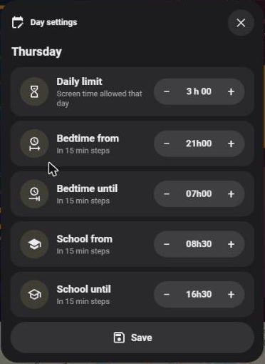
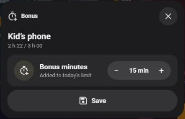
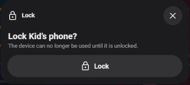
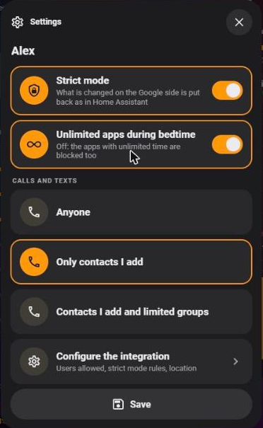
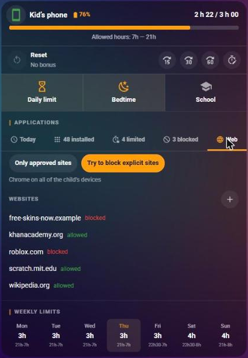

# Dashboard cards

The integration ships its own dashboard cards. They are loaded on every dashboard as soon as the integration is set up: nothing to install from the Marketplace, no resource to declare, no helper and no script. Add them from **Edit dashboard > Add card** (search "Family Link" or "Screen time"), each has a visual editor, or paste the YAML below.



[`lovelace-dashboard.yaml`](lovelace-dashboard.yaml) is the dashboard of the screenshot. To import it: **Settings > Dashboards > + Add dashboard > New dashboard from scratch**, open it, **Edit dashboard**, then the **Raw configuration editor** (top-right menu), paste, replace the three placeholder entity ids with yours (**Developer Tools > States**), **Save**.

| Card | What it shows and does |
|------|------------------------|
| `custom:familylink-card` | One phone or tablet: lock state and battery, time used against the limit (bonus included), allowed hours, why it is blocked or the next restriction, bonus bar, the daily limit / bedtime / school time tiles, the child's apps and websites, the weekly limits |
| `custom:parental-screen-time-card` | Today's screen time of several devices together: total against the sum of the limits, time left, next restriction, one tile per device with its lock state, hourly chart, and optionally the daily history below |
| `custom:parental-screen-time-history-card` | The daily history alone, one bar per day |
| `custom:familylink-location-card` | Where the child is, on Home Assistant's own map, with the place, the age of the fix and a refresh button |

The colours follow your theme (accent, success, warning and error colours); the dialogs are always dark. The screenshot uses the "iOS Themes" dark blue-red theme (Marketplace).

## Family Link card

```yaml
type: custom:familylink-card
entity: switch.kids_phone      # or device: <device id>, as the visual editor writes it
title: Kid's phone             # optional, the device name otherwise
compact: true                  # optional: header and bonus bar only, for a second device of the same child
language: fr                   # optional: en or fr, the language of Home Assistant otherwise
entities:                      # optional: replace the entity behind a role
  child: { school_time: automation.my_school_mode }
```

Choose a phone or a tablet, not the child: the card finds every entity of the device and of its child by itself. Everything the card changes goes through the integration's entities and actions, with the permissions of the logged-in user (see below).

| Part | Tap | Does |
|------|-----|------|
| Device icon | opens a confirmation | Locks or unlocks the device (`switch.<device>`). Never one tap: on a phone a scroll can land on the icon |
| Bell, next to the battery | opens a confirmation | Rings the device so it can be found |
| Gear, at the right | opens the settings | The child's settings: strict mode, apps with unlimited time during bedtime, who can call and text the child; for administrators, a link to the integration options |
| Bonus bar | +15 / +30 / +60, reset | Presses the bonus buttons of the device |
| Stopwatch | opens a dialog | A bonus of any length (`familylink.add_time_bonus`) |
| Daily limit, Bedtime, School | toggles | The child's switches |
| Applications tabs | Today, installed, limited, blocked | Tap an app to change its rule: always allowed, no limit of its own, a daily limit, paused (`familylink.pause_app`, a 1-minute limit the app comes back from with its earlier rule), or blocked |
| Web tab | filter pills, `+`, a site | Switches the Chrome filter (only the approved sites, or Google's filter), adds one or several sites as allowed or blocked, moves a site from one list to the other or removes it |
| Weekly limits | a weekday | The quota, the bedtime hours and the school hours of that weekday, in 15-minute steps. School hours show on the days that have school time in Family Link; with a lunch break, the start is the morning's and the end the afternoon's |

Under the bar, next to the allowed hours: why the device is blocked (bedtime, school time, daily limit reached, locked), in red, or else the next restriction. The tabs drop their icons, then their words, when the card is narrow.

| App rule | Website | Weekday |
|----------|---------|---------|
|  |  |  |

| Custom bonus | Lock confirmation | Settings |
|--------------|-------------------|----------|
|  |  |  |



A dialog keeps its draft until **Save**, and only sends what changed. When Google or Home Assistant refuses a change, the dialog stays open with the reason.

## Screen time cards

```yaml
type: custom:parental-screen-time-card
devices:                       # device ids (visual editor), or { entity: … } / { device: …, name: … }
  - entity: switch.kids_phone
    name: Kid's phone
  - entity: switch.kids_tablet
history: true                  # optional: the daily history below, as a second card
days: 14                       # optional: 3 to 31
chart: false                   # optional: no hourly chart
entities: [sensor.console_screen_time]   # optional: any other time sensor in minutes
sources:                       # optional: the same, with a name, a limit, a remaining time, a lock
  - entity: sensor.switch_used_screen_time
    name: Switch
    limit: number.switch_max_screentime_today
```

The charts read Home Assistant's long-term statistics of the time sensors, so the history fills up day after day. A limit, a remaining time or a lock shared by several devices counts once.

**With Microsoft Family Safety.** The same file ships with [Microsoft Family Safety for Home Assistant](https://github.com/noiwid/HAFamilySafety): its PCs and Xbox can be listed in `devices` next to the phones and tablets, and the card shows all of the child's screen time together.

## Location card

```yaml
type: custom:familylink-location-card
entity: device_tracker.firstname_name_family_link   # or device: <the phone>
zoom: 15                       # optional
height: 300                    # optional, in pixels
```

It needs location tracking enabled in the integration options. The refresh button asks the phone for a fresh fix (`familylink.refresh_location`), which uses its battery.

## Who can change things

The cards add no permission of their own: every change is a call to a Family Link entity or action, checked like any other. With the option **Users allowed to control Family Link** filled in, a user who is not in it (a child with a Home Assistant account, for example) sees the cards but every change is refused. See [Who may call a service](../SERVICES.md#who-may-call-a-service).

## Weekly limits card alone

[`weekly-limits-card.yaml`](weekly-limits-card.yaml) is the earlier, standalone version of the weekly limits row, made of Marketplace cards (button-card, card-mod, Mushroom and vertical-stack-in-card). The Family Link card has the same row built in. Paste it as a new card (**Add card > Manual**) and replace `firstname_name` with your child's slug.

With strict mode on, the values written from the dashboard are the reference the integration puts back if they are changed in the Family Link app.
